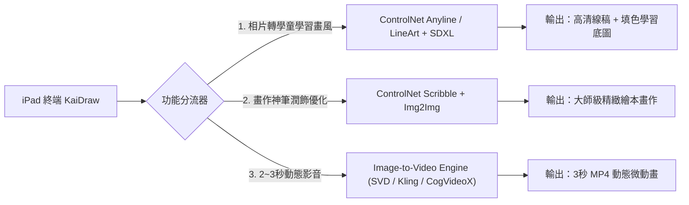
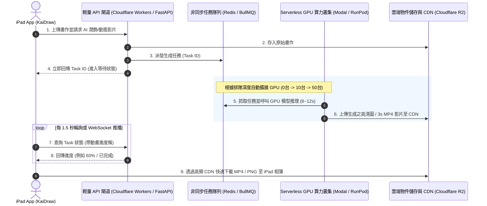

# KaiDraw AI 核心能力、雲端架構與商業化落地完整規劃書

> **專案定位**：以「啟發兒童創造力」為核心的 iPad 擬物畫室。  
> **核心目標**：透過 AI 技術實現「相片轉學童學習畫風」、「草稿/畫作 AI 潤飾優化」、「靜態畫作轉 2~3 秒動態影片」，並以 Apple App Store 訂閱制模型實現可持續盈利。

---

## 一、 核心問題直接解答（Executive Summary）

### 1. 照片轉兒童畫風，可否介接「圖生圖 (Image-to-Image)」AI 模型？
**完全可以，而且這是當前最主流且效果最好的做法。**  
- 透過 **ControlNet (LineArt / Scribble / Canny)** 搭配針對兒童繪本微調的輕量化模型（如 SDXL-Turbo 或 Flux-Schnell），可以精準保留照片中的物體外觀結構，並轉換為「粗線條描邊、平塗色塊、高對比度」的學童友好線稿與繪本風格，極度適合兒童臨摹與填色。

### 2. 雲端是否有「免費伺服器」可以架設地端模型並開放 API 給 App 呼叫？
**結論：開發與測試期有免費額度，但商業化量產「絕不能」依賴完全免費的雲端 GPU。**
- **真實情況**：AI 繪圖尤其是「圖生影音（Video Generation）」需要高算力的 NVIDIA 專業顯卡（A10G、A100、H100 或 RTX 4090）。雲端大廠（AWS、Google Cloud、Azure）因電力與硬體成本極高，**不會提供長期免費且能承載商用 API 呼叫的 GPU 伺服器**。
- **免費/極低成本方案（開發測試期）**：
  - **Google Colab (免費 T4 GPU)**：可透過 Ngrok 臨時暴露 API 進行研發測試，但每次連線 1~2 小時會斷開，不可用於線上生產環境。
  - **Hugging Face Spaces (免費 CPU / 贈送額度)**：可用於概念驗證（PoC），但無商業級併發保障。
- **商用生產環境的最佳解法（Serverless 按秒計費，每張圖幾分錢台幣）**：
  - 採用 **Modal.com**、**RunPod Serverless** 或 **Fal.ai / Replicate**：平時**無人使用時機器關閉（成本為 0 美元）**，有人在 iPad 點擊生成時才按秒喚醒計算。單張圖生成成本僅約 **\$0.002 ~ \$0.005 美元（約 0.06 ~ 0.16 元新台幣）**。

### 3. 使用者畫完後「AI 潤飾優化」與「轉成 2~3 秒動態影片」的實現方式？
- **AI 畫作潤飾優化（Magic Finish）**：
  - 採用 **ControlNet Scribble + Image-to-Image**：將孩子畫布上的線條和色彩作為「形狀與色彩約束」，控制 Denoising Strength（降噪強度約 0.45~0.6），在保留孩子原始創意構圖的前提下，將塗鴉昇華為迪士尼/皮克斯級別的繪本插畫。
- **2~3 秒動態影片生成（Image-to-Video）**：
  - 採用前沿輕量開源模型如 **SVD-XT (Stable Video Diffusion)** 或 **CogVideoX / LTX-Video**，或直接介接商業級 API（如 **Fal.ai 的 Minimax / Kling / Luma API**）。
  - 單次 2~3 秒影片生成耗時約 6~15 秒，生成成本約 **\$0.03 ~ \$0.06 美元（約 1~2 元新台幣）**。

### 4. 高並發（大量使用者同時呼叫 API）會不會造成伺服器卡死？
**如果採用傳統固定虛擬機（如自己租一台 AWS EC2 GPU 伺服器），一定會卡死或崩潰。**  
但現代雲原生架構解決這個問題有一套標準的「**非同步任務隊列 + Serverless 自動彈性擴縮**」模式：
1. iPad 送出請求 $\rightarrow$ 進入雲端佇列（Redis / BullMQ），立即回傳任務 ID。
2. iPad 畫面顯示趣味動畫（如：*「小探險家 Kai 正在施展魔法賦予生命... 35%」*）。
3. 雲端 Serverless GPU 叢集依據排隊量**自動從 1 台擴充到 50 台**，幾秒內平行處理完畢後將 MP4 影片與高清 PNG 存入 CDN，推播給 iPad 完成下載。

---

## 二、 三大 AI 核心能力技術方案深度拆解



### 1. 功能一：相片轉學童學習畫風（Photo-to-Kids Sketch & Coloring Book）
- **核心目標**：將家長或孩子拍的照片（寵物、玩具、家人、風景）變成孩子**畫得出來、臨摹得懂**的風格。
- **技術架構**：
  - **前處理**：雙邊濾波（Bilateral Filter）或漫畫平滑化（Cartoonization），消除照片中過於瑣碎的微小雜訊。
  - **線條提取**：`ControlNet Anyline` 或 `LineArt`，提取乾淨俐落的封閉外輪廓線。
  - **繪畫填色風格**：使用預先訓練好的 LoRA（例如：`Children Storybook Illustration Style` 或 `Ghibli Style`），產出具備高純度色彩、柔和漸層的童趣範本。
- **iPad 本地輕量化優勢（端側方案）**：
  - 基礎黑白邊緣提取可**完全在 iPad 端側（CoreML / Apple Vision Framework）即時 0 秒完成**，不需要消耗任何雲端伺服器成本！只有當使用者想要高階「AI 重繪童話風」時才呼叫雲端 API。

### 2. 功能二：AI 畫作潤飾優化（Magic Finish / 創意神筆）
- **痛點解決**：孩子畫的畫往往線條歪扭、色彩斑駁，若直接覆蓋重畫會抹煞孩子的原創成就感。
- **解決方案**：
  - 提取孩子目前畫布的 `paintCanvas` 作為輸入圖。
  - 採用 **ControlNet Scribble**（塗鴉約束）：強制 AI 的主體結構、眼睛位置、四肢比例完全遵循孩子的筆觸。
  - 提示詞注入：在 Prompt 中固定前綴 `masterpiece, high quality children book illustration, vibrant gouache and watercolor texture, whimsical, charming`。
  - 產出結果：像是一本真正出版的精緻繪本插圖，家長與孩子看到對比圖會產生極強的驚艷感與分享慾望。

### 3. 功能三：2~3 秒動態影片賦生（Alive Canvas / 讓畫動起來）
- **目標效果**：小狗會搖尾巴吐舌頭、熱氣球會在天空中隨風起伏、水彩雲朵會緩緩飄動。
- **技術路線選擇**：
  | 方案類型 | 代表模型 / API | 優勢 | 劣勢 | 單次成本 |
  | :--- | :--- | :--- | :--- | :--- |
  | **開源自建 (Serverless)** | **Stable Video Diffusion (SVD-XT)** | 成本極低、自由可控、生成 2~3 秒僅需 8 秒 | 動作幅度相對溫和 | 約 \$0.02 ~ \$0.03 美元 |
  | **開源最新 (Serverless)** | **CogVideoX-5B / LTX-Video** | 畫面連貫性極高、支援文字 Prompt 驅動動作 | 需要 24GB+ 顯存 GPU | 約 \$0.03 ~ \$0.05 美元 |
  | **商業託管 API** | **Fal.ai (Minimax / Kling / Luma)** | 零維護、品質頂級、生動自然、保證高可用 | 成本略高於開源自建 | 約 \$0.05 ~ \$0.08 美元 |

---

## 三、 雲端伺服器架構與防崩潰高並發設計

為了因應未來 App Store 上架後，數百或數千名付費用戶同時發送生成請求，推薦採用 **「現代 Serverless 彈性架構」**，完全摒棄「自己買一台伺服器常開」的落後模式。



### 為什麼這套架構能兼顧「低成本」與「高抗壓」？
1. **零閒置成本（Cold to 0）**：深夜無人畫畫時，雲端 GPU 實例為 0，一毛錢伺服器費用都不會產生。
2. **高並發瞬間擴容**：當週末下午有 200 個孩子同時點擊「讓畫動起來」，Serverless 平臺自動在 15 秒內啟動 30~50 個 GPU 容器平行運算，不會有任何一台伺服器當機或記憶體溢出。
3. **優雅的客戶端體驗**：非同步排隊架構搭配 iPad 端的進度條與小探險家 Kai 動畫，孩子不但不會覺得卡頓，反而充滿「期待奇蹟發生」的心理樂趣。

---

## 四、 商業化收費模型與單元毛利測算（Unit Economics）

未來 App 上架 Apple Store，採用 **In-App Purchase (IAP) 自動續訂訂閱制**，成本與收益試算如下：

### 1. 單次 AI 運算成本矩陣
- **相片轉黑白學習線稿（本地處理）**：`$0.00`（完全在 iPad 端側完成）。
- **相片 AI 高階繪本風重繪**：`~$0.004 美元`（約合新台幣 0.13 元）。
- **畫作神筆潤飾優化**：`~$0.006 美元`（約合新台幣 0.19 元）。
- **2~3 秒動態影片賦生**：`~$0.04 美元`（約合新台幣 1.28 元）。

### 2. 訂閱方案設計範例（Apple Store 推薦定價）
- **免費版（Free Tier）**：
  - 基礎三大畫具（水彩、蠟筆、馬克筆）。
  - 本地相片轉黑白描邊草稿（無限次使用）。
  - 每週贈送 2 次體驗「畫作神筆優化」。
- **KaiDraw Pro VIP 訂閱（週費 / 月費 / 年費）**：
  - **定價**：
    - 週訂閱：`$2.99 美元 / 週`（約合 NT\$ 95 / 週）
    - 月訂閱：`$7.99 美元 / 月`（約合 NT\$ 250 / 月）
    - 年訂閱：`$49.99 美元 / 年`（約合 NT\$ 1,600 / 年）
  - **VIP 權益**：
    - 解鎖 4 款頂級真實物理畫紙（宣紙、雲彩紙、冷壓水彩紙、暖灰卡紙）。
    - 每月享有 **150 次 AI 畫作大師潤飾** + **30 次 3秒動態影片賦生**。
    - 無限白瓷調色盤雲端存檔與 4K 超清畫作無水印匯出。

### 3. 毛利率與損益平衡試算
- 假設一個典型活躍付費會員一個月內用滿：
  - 100 次畫作潤飾：$100 \times \$0.006 = \$0.60$
  - 20 次 3秒影片生成：$20 \times \$0.04 = \$0.80$
  - 雲端 CDN 流量與儲存：約 $\$0.10$
  - **該使用者單月雲端算力總成本**：約 **\$1.50 美元**（約 NT\$ 48）。
- **財務毛利分析**：
  - 蘋果商店抽成（小企業方案 15%）：月費 $\$7.99 \times 85\% = \$6.79$ 美元。
  - 扣除 AI 算力成本（$\$1.50$ 美元）：**淨毛利高達 \$5.29 美元 / 人 / 月（毛利率超過 77%）！**

---

## 五、 開發落地路線圖（Implementation Roadmap）

```
階段一：PoC 驗證與模型微調 (1~2 週)
  ├── 1. 在 Modal / Fal.ai 上部署 ControlNet LineArt 與 Scribble 管道
  ├── 2. 調校針對「學童繪本風格」的專屬 Prompt 與 LoRA
  └── 3. 測試 SVD / CogVideoX 對兒童簡筆畫的動態生成穩定度

階段二：雲端 Serverless API 與佇列搭建 (1 週)
  ├── 1. 搭建輕量 FastAPI + Redis 非同步隊列中繼伺服器
  ├── 2. 接入 Cloudflare R2 儲存圖片與 MP4 影片
  └── 3. 撰寫 iPad 前端非同步輪詢與下載保存至相簿邏輯

階段三：前端介面整合 (1 週)
  ├── 1. 畫布導航欄加入「✨ 神奇潤飾」與「🎬 讓畫動起來」按鈕
  ├── 2. 製作生動的 Kai 魔法生成等待動畫與 2~3 秒動態預覽播放器
  └── 3. 本地相片轉草稿與雲端生成按鈕的無縫切換

階段四：App Store 上架與 StoreKit 2 訂閱整合 (1~2 週)
  ├── 1. Capacitor / iOS 原生殼打包與 iPad 壓感深度優化
  ├── 2. 接入 RevenueCat / StoreKit 2 實現訂閱付費牆與家長閘門
  └── 3. 提交 App Store 審核上架
```

> **總結結論**：  
> 這套功能完全可行，且具備極高的商業附加價值與家長付費意願。架構上採用「**端側處理基礎線稿（0 成本）+ 雲端 Serverless 按需計費（高毛利）**」的混合模式，既能保證日常繪畫 0 延遲，又能在高並發時彈性應對，完全無須負擔昂貴的固定 GPU 伺服器月租費用！
